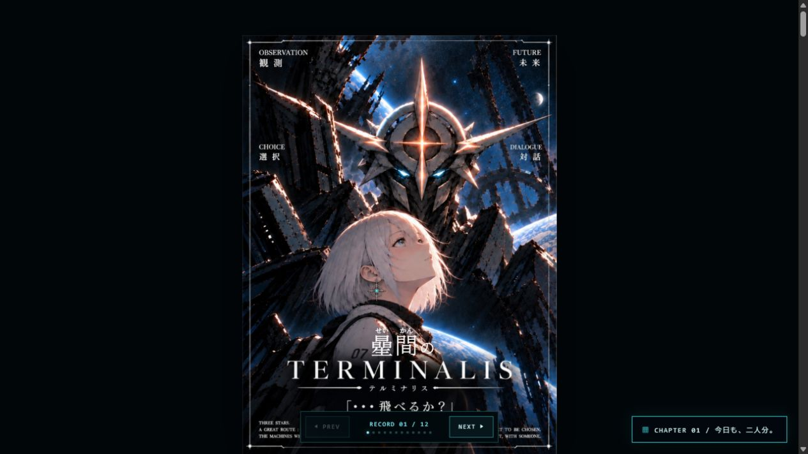

# Napetune

**M5StackとNapeProを組み合わせ、キーマップの表示・変更、ゲームやアプリの操作、対応ケース・筐体を開発するプロジェクトです。**

作者自身の[TheExtend](https://github.com/YMG-CODE/M5stack_TheExtend)から発展させています。

<a href="https://ymg-code.github.io/napetune/"></a>

『曐間のTERMINALIS』Web作品ビューアのスクリーンショットです。M5Stackの実機画面ではありません。
[Web作品を読む](https://ymg-code.github.io/napetune/) / [実機写真・画面の掲載準備](https://github.com/YMG-CODE/napetune/issues/5)

## 主な機能

- **TUNING MODE**：NapeProのキーマップを表示・変更。
- **GAMING MODE**：NapeProでゲームやアプリを操作。MECHA、DEMO、LOUNGE、HANGARを収録。
- **GLASS2連携**：操作ガイドやメッセージを手元に表示。
- **作品・ハードウェア**：オリジナル作品『曐間のTERMINALIS』と連動。対応3Dプリントケース・筐体も開発中。

## 対応ハードウェア

M5Stack本体、USB Module v1.2 / MAX3421E、NapeProの対応USBドングルを使用します。
GLASS2 Unitは任意、保存・外部素材にはmicroSDを使用します。

| 構成 | 動作確認の状態 |
|---|---|
| CoreS3 Lite | **制約あり**：移植初版の実機動作は確認済み。現行公開版の再確認は未検証。モニター設定に制約あり |
| Core2標準 | **制約あり**：ビルド確認済み、現行公開版の実機は未検証。標準USB CSとGLASS2のピンが競合 |
| Core2 USB CS19 | **未検証**：ビルド確認済み、現行公開版の実機結果は未記録 |

[配線・確認範囲の詳細](docs/hardware.md)

## 導入方法

1. リポジトリをダウンロード、またはcloneします。
2. VSCode + PlatformIOで **`prototype/` フォルダー**を開きます。
3. CoreS3 Liteは `m5stack-cores3-lite-app` を選び、Uploadします。

```sh
pio run -d prototype -e m5stack-cores3-lite-app -t upload
```

[Core2・COMポート・モニターを含む導入手順](docs/getting-started.md)

## 開発状況

趣味で開発している体験版・プロトタイプです。対応ファームウェアのソースを公開しており、ソフトウェア自体を有償で頒布する予定はありません。
不具合・実機確認・開発予定は[GitHub Issues](https://github.com/YMG-CODE/napetune/issues)で管理します。
[ケース等の頒布構想](https://github.com/YMG-CODE/napetune/issues/6) / [ドキュメント一覧](docs/README.md)

## ライセンス・クレジット

開発・オリジナル作品：**YMGWorks**。

- 独自の対象コード：[MIT](prototype/LICENSE)。条件に従って商用利用・改変・再配布ができます。
- ストーリー、キャラクター、メカデザイン等：[作品素材の利用条件](prototype/CONTENT_LICENSE.md)。MIT対象外です。
- 外部ライブラリ・フォント：[第三者ライセンス表示](prototype/THIRD_PARTY_NOTICES.md)。各作者の権利表示を維持します。

[全体の適用範囲](LICENSE.md) / [混在ソースの区分](prototype/LICENSE_SCOPE.md) /
[作品素材の対象一覧](prototype/CONTENT_MANIFEST.json)

Web版とこの画面キャプチャの作品表現も、独自コードのMIT対象ではありません。
コードの商用利用許可は作品素材の商用利用許可を含みません。
