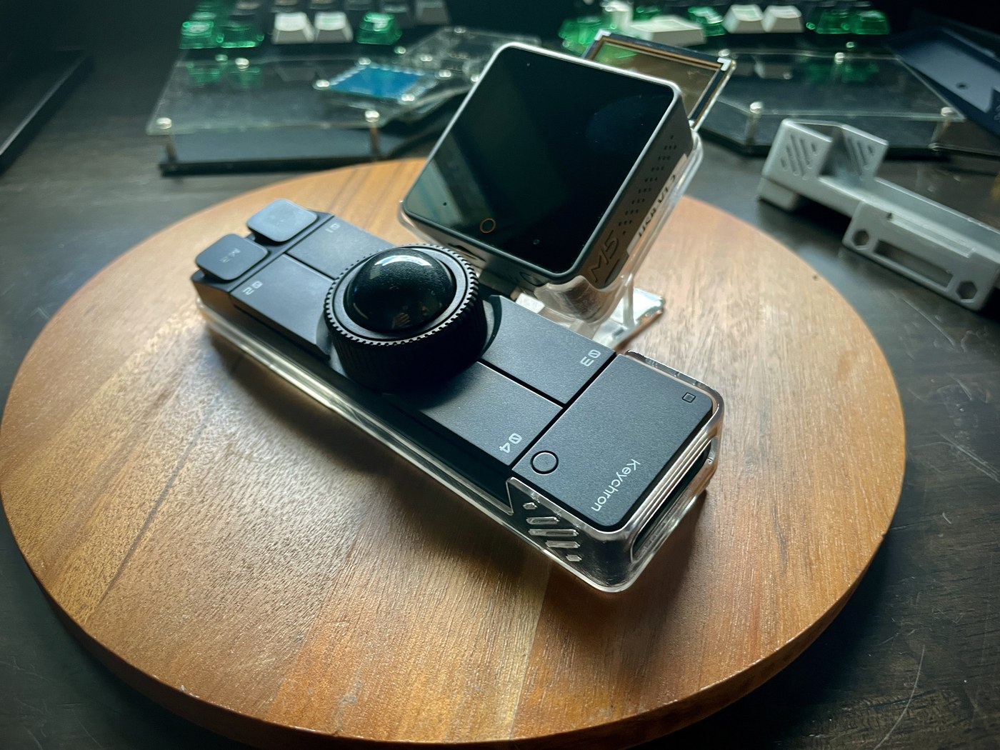
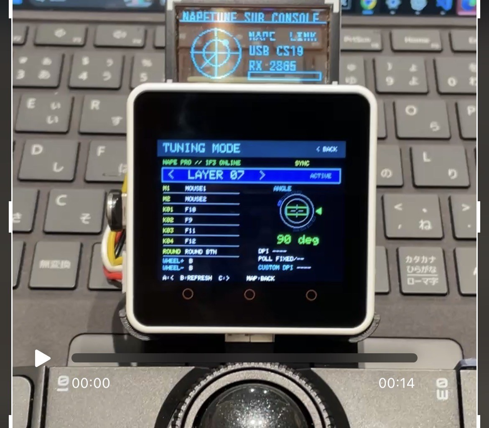
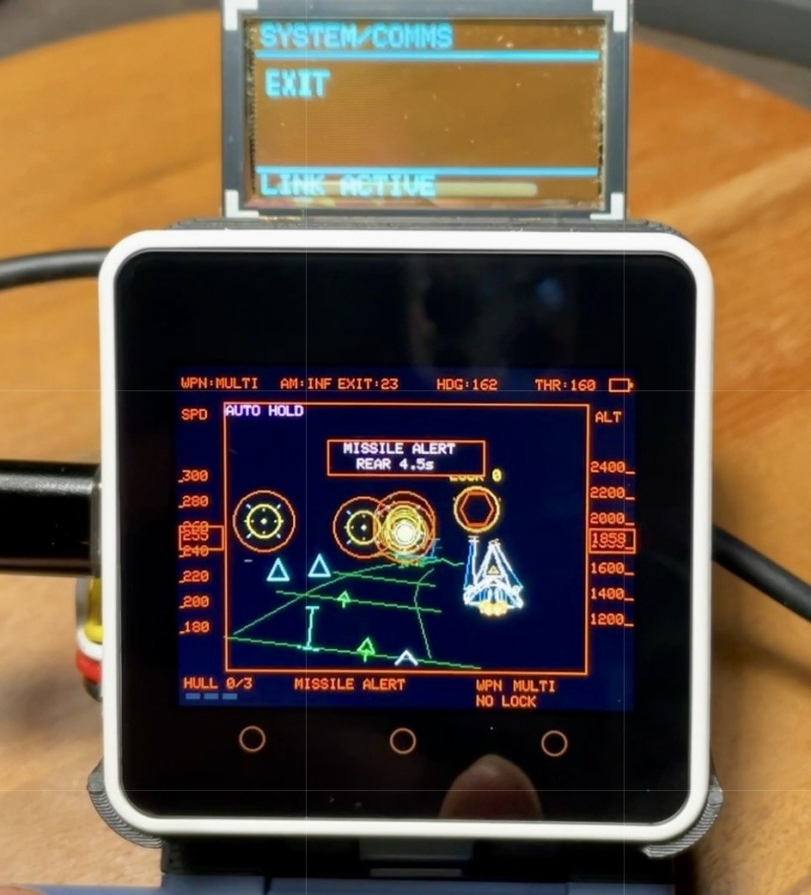

# Napetune

**M5Stackと[Keychron Nape Pro](https://www.keychron.com/products/keychron-nape-pro-wireless-trackball-mouse)を組み合わせ、キーマップの表示・変更、ゲームやアプリの操作、対応ケース・筐体を開発するプロジェクトです。**

Napetuneは、YMGWorksによる非公式の個人開発プロジェクトです。

作者自身の[TheExtend](https://github.com/YMG-CODE/M5stack_TheExtend)から発展させています。



Nape ProとM5Stackを組み合わせたケース試作機です。

| TUNING MODE | GAMING MODE |
|---|---|
|  |  |

[本体・ケース・画面の写真を見る](docs/gallery.md) / [Web作品を読む](https://ymg-code.github.io/napetune/)

## 主な機能

- **TUNING MODE**：Nape Proのキーマップを表示・WEBツールなしで変更・保存。
- **GAMING MODE**：Nape Proでゲーム※やアプリを操作。
- **GLASS2連携**：操作ガイドやメッセージを手元に表示。
- **※作品・ハードウェア**：オリジナル作品『曐間のTERMINALIS』と連動。対応3Dプリントケース・筐体も開発中。
 [Web作品を読む](https://ymg-code.github.io/napetune/)

## 動作イメージ（Xにて開発機の動画をポスト）
- [**TUNING MODE**](https://x.com/ymg_yamag/status/2089270332968640803?s=20)
- [**GAMING MODE1**](https://x.com/ymg_yamag/status/2095151337436766416?s=20)
- [**GAMING MODE2**](https://x.com/ymg_yamag/status/2098027796014698704?s=20)
- [**GAMING MODE3**](https://x.com/ymg_yamag/status/2100614865878765753?s=20)
- [**GAMING MODE4**](https://x.com/ymg_yamag/status/2103145974910910658?s=20)
- [**GAMING MODE5**](https://x.com/ymg_yamag/status/2106426926760169894?s=20)
- [**3DPCASE1**](https://x.com/ymg_yamag/status/2103475342216466468?s=20)
- [**3DPCASE2**](https://x.com/ymg_yamag/status/2096482864905031841?s=20)

## 対応ハードウェア

M5Stack CoreS3 Lite本体、USB Module v1.2 / MAX3421E、Nape Proの対応USBドングルを使用します。
保存・外部素材にはmicroSDを使用します。

| 構成 |
|---|
| CoreS3 Lite |
| USB Module v1.2 / MAX3421E |
| GLASS2 Unit |

[配線・確認範囲の詳細](docs/hardware.md) / [システム構成・接続図](docs/system.md)

## 導入方法

[機種別ファームウェアをダウンロードして書き込む](docs/firmware.md)ことができます。
ソースからビルドする場合は、次の手順を使用します。

1. リポジトリをダウンロード、またはcloneします。
2. VSCode + PlatformIOで **`prototype/` フォルダー**を開きます。
3. CoreS3 Liteは `m5stack-cores3-lite-app` を選び、Uploadします。

```sh
pio run -d prototype -e m5stack-cores3-lite-app -t upload
```

[Core2・COMポート・モニターを含む導入手順](docs/getting-started.md)

## 開発状況

趣味で開発している体験版・プロトタイプです。
**Core2版はデモとして提供し、今後はCoreS3 Liteを主体に開発します。**
 [ドキュメント一覧](docs/README.md)

開発状況については[X(@ymg_yamag)](https://x.com/search?q=from:ymg_yamag+Napetune+filter:videos&f=live&utm_source=chatgpt.com)でも随時発信します。

## ライセンス・クレジット

開発・オリジナル作品：**YMGWorks**。

記載の製品名・ブランド名は、各権利者に帰属します。

- 独自の対象コード：[MIT](prototype/LICENSE)。条件に従って商用利用・改変・再配布ができます。
- ストーリー、キャラクター、メカデザイン等：[作品素材の利用条件](prototype/CONTENT_LICENSE.md)。MIT対象外です。
- 外部ライブラリ・フォント：[第三者ライセンス表示](prototype/THIRD_PARTY_NOTICES.md)。各作者の権利表示を維持します。

[全体の適用範囲](LICENSE.md) / [混在ソースの区分](prototype/LICENSE_SCOPE.md) /
[作品素材の対象一覧](prototype/CONTENT_MANIFEST.json)

Web版と掲載画像に含まれる作品表現も、独自コードのMIT対象ではありません。
コードの商用利用許可は作品素材の商用利用許可を含みません。
