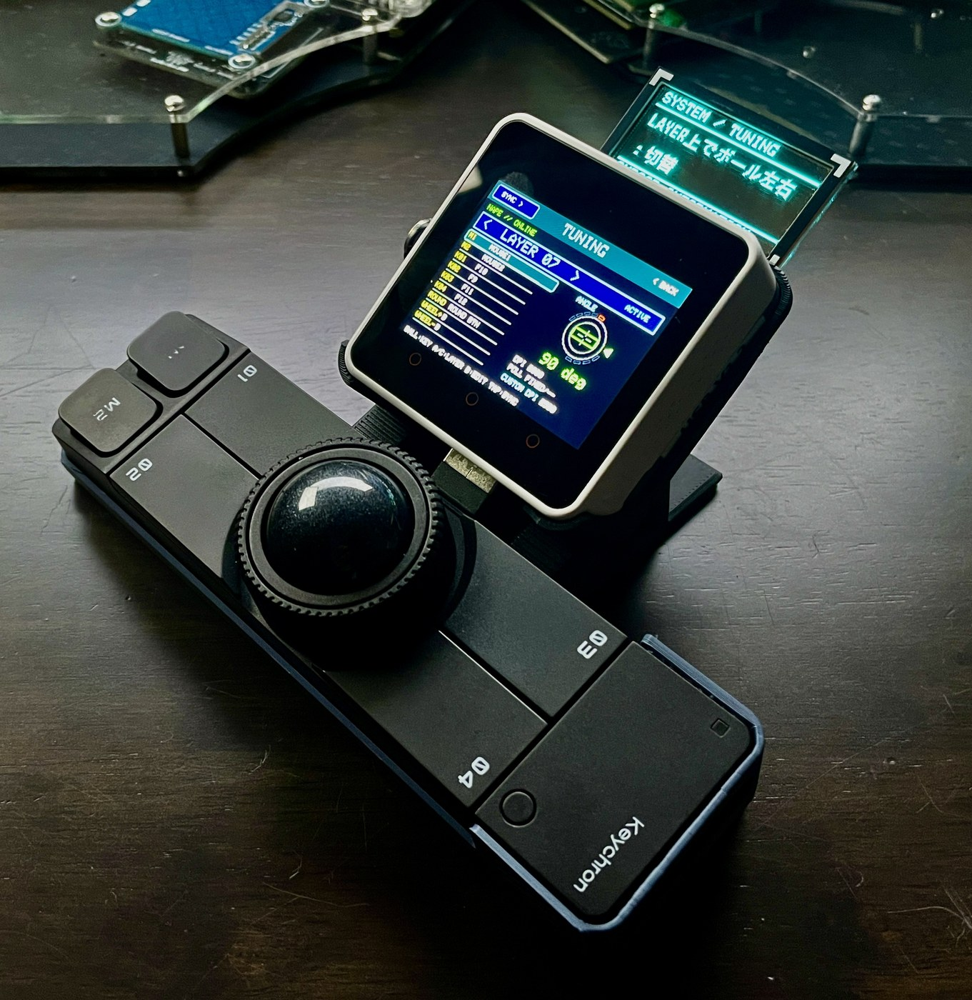
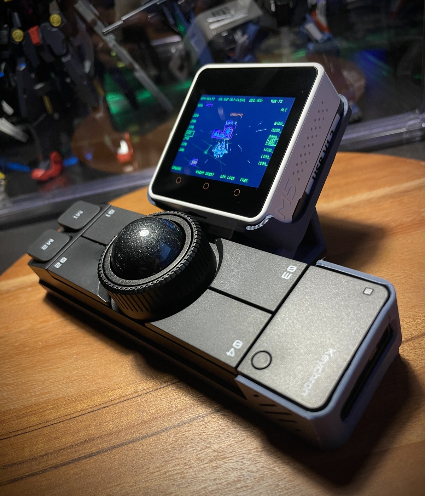
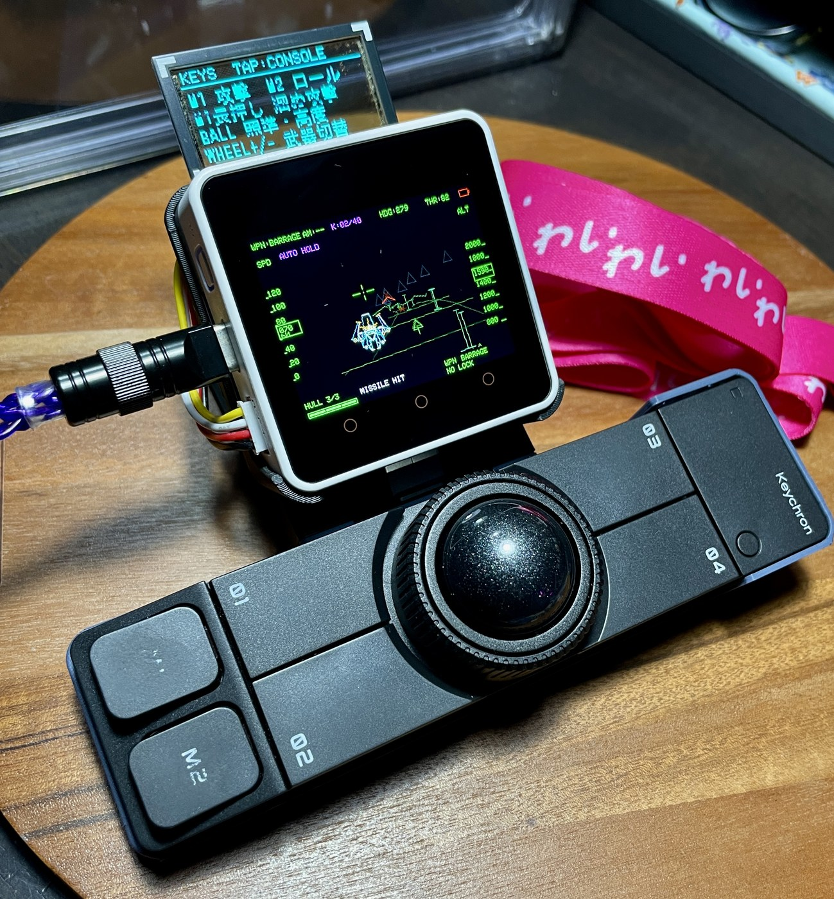
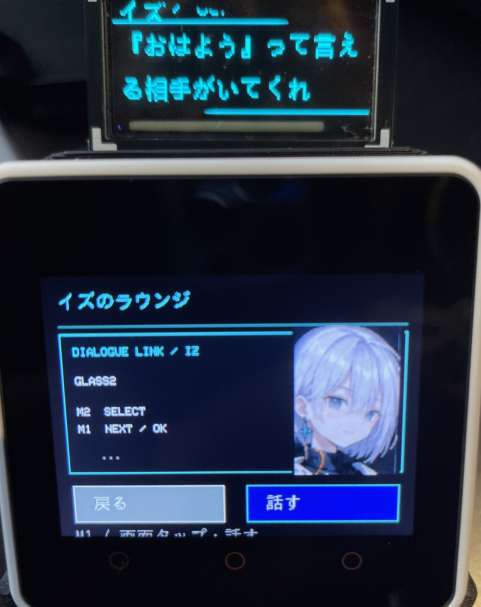
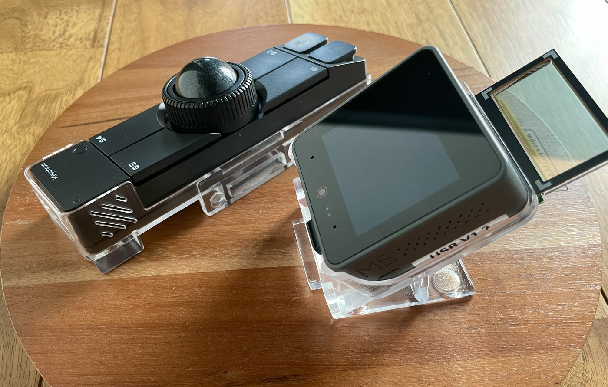
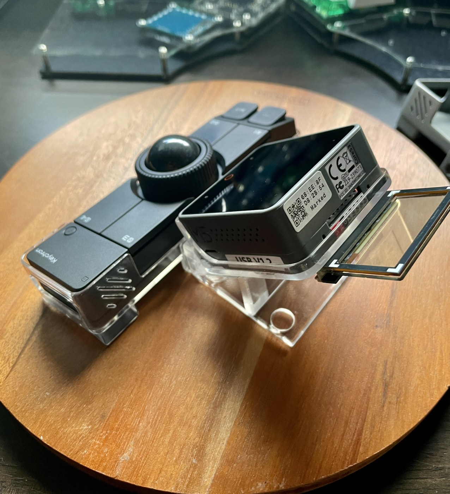

# 本体・ケース・画面

YMGWorks提供の開発機・試作ケースの写真です。写真ごとに開発時期・本体・画面が異なり、公開版と表示が異なる場合があります。
対応機種と確認範囲は[対応ハードウェア](hardware.md)を参照してください。

## 本体と操作

| TUNING MODE | GAMING MODE |
|---|---|
|  |  |

本体の表示とGLASS2のガイドを組み合わせて操作します。

## 画面

| キーマップ・レイヤー | ゲーム | ラウンジ |
|---|---|---|
|  |  |  |

## ケース試作

| 分離した状態（マグネット式着脱） | 背面・取り付け部 |
|---|---|
|  |  |

[READMEへ戻る](../README.md)
