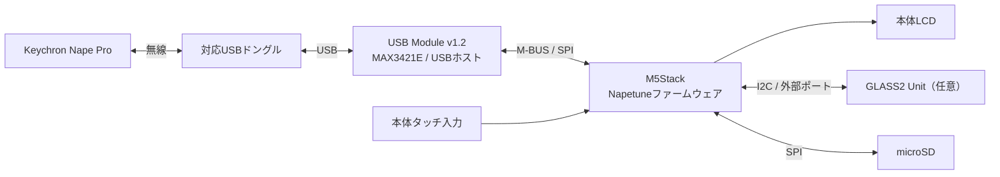
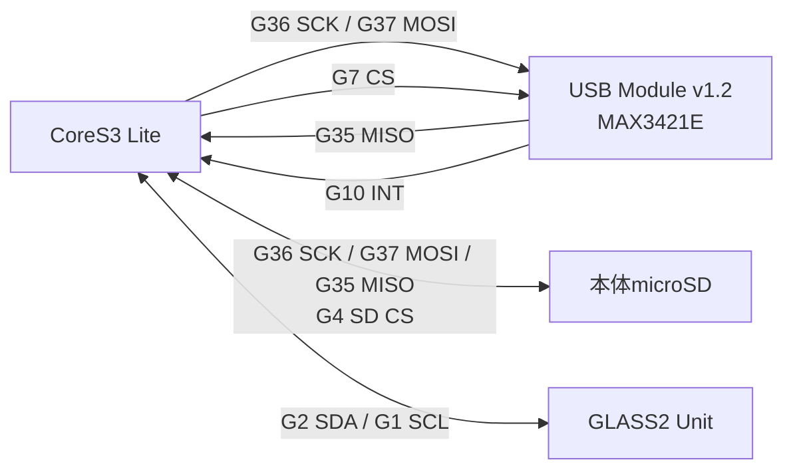

# システム構成・接続図

## システム構成

TUNING MODEではキーマップの表示・変更・保存、GAMING MODEではゲームやアプリへの入力に使います。
USBドングルはUSB Module側に接続します。本体のUSB Type-Cは書き込み・電源・シリアルモニターに使用します。

## CoreS3 Liteの信号接続

これはファームウェアが使用するGPIOを示す信号接続図です。USB ModuleはM-BUSに接続します。
電源・GND・コネクターの全端子を示す回路図ではありません。各機器の電源・接続仕様は公式資料に従ってください。

**図のG7 / G10はCoreS3 Lite側のGPIO番号です。USBモジュールのCS / INTスイッチ印字とは異なるため、印字をG7 / G10に変更するという意味ではありません。**
正常動作している設定は維持してください。

GPIOの根拠は[ボード設定](../prototype/include/napetune_board_config.h)、ビルド環境は[platformio.ini](../prototype/platformio.ini)です。
Core2のGPIOやCS変更時の条件は[配線表](hardware.md)に記載しています。

- [M5Stack USB Module v1.2公式資料](https://docs.m5stack.com/en/module/Module_USB_v1.2)
- [M5Stack CoreS3公式資料](https://docs.m5stack.com/en/core/CoreS3)

[READMEへ戻る](../README.md)
